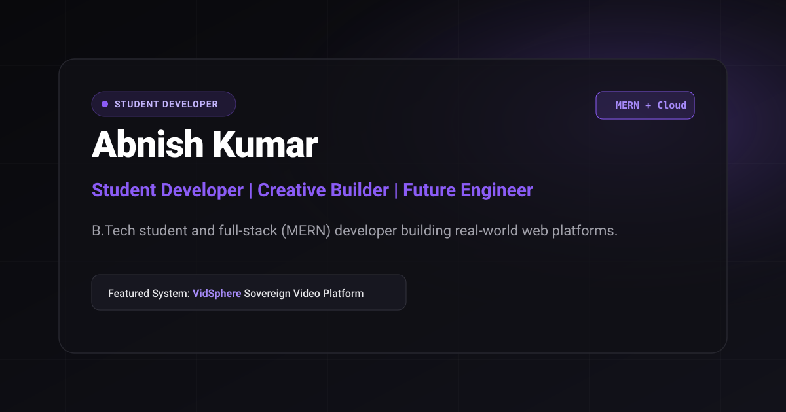

<div align="center">


# Abnish Kumar — Developer Portfolio

**Full-Stack MERN Developer · B.Tech CSE (AI/ML) · Problem Solver**

[](https://react.dev)
[](https://www.typescriptlang.org)
[](https://vite.dev)
[](https://tailwindcss.com)
[](https://www.framer.com/motion/)
[](LICENSE)

<br />

[**🌐 Live Preview**](https://abnishaiml.github.io) · [**📄 Resume**](public/ABNISH%20KUMAR%20UPDATED%20RESUME.pdf) · [**💻 GitHub**](https://github.com/AbnishAIML) · [**🔗 LinkedIn**](https://www.linkedin.com/in/ABNISHAIML) · [**🧩 LeetCode**](https://leetcode.com/u/ABNISHAIML)

<br />



</div>

---

## ⚡ About This Project

A modern, high-performance developer portfolio built with **React 18**, **TypeScript**, **Vite**, and **Tailwind CSS** — featuring a glassmorphic UI, interactive particle canvas, dual-mode hero section, and a fully responsive design system. Every piece of content is driven by a **single source of truth** making it effortless for AI agents or developers to iterate on.

### ✨ Feature Highlights

| Feature | Description |
|:---|:---|
| 🖥️ **Interactive Terminal Hero** | Typewriter-animated bash terminal cycling through real `whoami`, `cat stack.json`, and `git status` commands |
| 🎨 **Dual Theme System** | Dark (Obsidian `#070810`) ↔ Light (Alabaster `#fafafa`) with FOUC-free initialization and localStorage persistence |
| 🔮 **Spotlight Cards** | Mouse-tracking radial gradient spotlight on hover — pure CSS + React, zero libraries |
| 🌌 **Particle Canvas** | GPU-efficient canvas background with 55 interconnected indigo + cyan particles |
| 🎯 **Custom Magnetic Cursor** | Spring-lag cursor with dot + ring following mouse via `requestAnimationFrame` lerp |
| 📊 **Live GitHub Stats** | Real-time GitHub API integration — repos, followers, bio pulled from [@AbnishAIML](https://github.com/AbnishAIML) |
| 🏗️ **VidSphere Architecture** | Interactive SVG data-flow diagram mapping the full MERN + MVC + Cloudinary pipeline |
| 🏆 **Certificate Verification** | TruScholar-verified credential modal with PDF preview and blockchain verification link |
| ♿ **Accessibility First** | Skip-link, ARIA landmarks, `prefers-reduced-motion` hook, keyboard navigation, semantic HTML |
| 📱 **Fully Responsive** | Mobile-first design with fluid `clamp()` typography and collapsible hamburger navigation |

---

## 🛠️ Tech Stack

<div align="center">

| Layer | Technologies |
|:---:|:---|
| **Frontend** | React 18 · TypeScript 5.7 · Vite 6 · Tailwind CSS 3.4 |
| **Animation** | Framer Motion 11 · Canvas API · CSS Keyframes |
| **Icons** | Lucide React (tree-shakeable, 1000+ icons) |
| **Utilities** | clsx · tailwind-merge · Custom hooks |
| **Fonts** | Space Grotesk · Plus Jakarta Sans · JetBrains Mono |
| **SEO** | Open Graph · Twitter Cards · JSON-LD Schema.org · Sitemap |
| **Build** | Vite (ESBuild + Rollup) · PostCSS · Autoprefixer |
| **Lint / Types** | TypeScript strict mode · ESLint-ready |

</div>

---

## 🚀 Quick Start

```bash
# Clone the repository
git clone https://github.com/AbnishAIML/portfolio.git
cd portfolio

# Install dependencies
npm install

# Start development server (http://localhost:5173)
npm run dev

# Type-check + production build
npm run build

# Preview production build locally
npm run preview
```

> **Note:** The project includes a `postinstall` script that patches Rollup for Windows AppLocker compatibility using `@rollup/wasm-node` as a fallback.

---

## 📂 Project Architecture

```
PORTFOLIO/
│
├── public/                            # Static assets (copied to dist/)
│   ├── ABNISH KUMAR UPDATED RESUME.pdf
│   ├── abnish.png                     # Avatar photograph
│   ├── techtrixHackathon.webp         # Certificate image
│   ├── techtrixHackathon.pdf          # Certificate PDF
│   ├── favicon.svg                    # Browser favicon
│   ├── og-image.svg                   # Social share image (1200×630)
│   ├── robots.txt                     # Search engine directives
│   └── sitemap.xml                    # XML sitemap for SEO
│
├── src/
│   ├── data/
│   │   └── content.ts                 # ★ SINGLE SOURCE OF TRUTH ★
│   │
│   ├── types/
│   │   └── index.ts                   # TypeScript interfaces for all data
│   │
│   ├── hooks/
│   │   ├── useTheme.ts                # Dark/Light theme state & toggle
│   │   ├── useScrollSpy.ts            # Active section detection via IntersectionObserver
│   │   ├── useGitHubData.ts           # Live GitHub API fetch hook
│   │   └── usePrefersReducedMotion.ts # Accessibility: respects OS motion settings
│   │
│   ├── components/                    # Reusable UI primitives
│   │   ├── Navbar.tsx                 # Responsive nav with scroll spy & mobile menu
│   │   ├── HeroTerminal.tsx           # Interactive typing terminal animation
│   │   ├── ArchitectureDiagram.tsx    # SVG architecture data-flow diagram
│   │   ├── Avatar.tsx                 # Click-to-toggle circle ↔ square avatar
│   │   ├── BackgroundCanvas.tsx       # Particle constellation canvas
│   │   ├── CustomCursor.tsx           # Magnetic spring cursor (desktop)
│   │   ├── SectionHeader.tsx          # Consistent section title with eyebrow badge
│   │   ├── SkillCard.tsx              # Individual skill with icon & context badge
│   │   ├── SpotlightCard.tsx          # Mouse-tracking spotlight gradient card
│   │   ├── SkipLink.tsx               # Accessibility skip-to-content link
│   │   └── ThemeToggle.tsx            # Sun/Moon theme switcher button
│   │
│   ├── sections/                      # Page sections (each = one viewport block)
│   │   ├── HeroSection.tsx            # Dual-mode: Terminal ↔ Portrait toggle
│   │   ├── AboutSection.tsx           # Academic background & engineering ethos
│   │   ├── SkillsSection.tsx          # 27-skill matrix in 6 categories
│   │   ├── FeaturedProjectSection.tsx # VidSphere deep dive + architecture diagram
│   │   ├── CurrentlyBuildingSection.tsx # Active workstreams & progress
│   │   ├── GitHubActivitySection.tsx  # Live GitHub profile stats
│   │   ├── MilestonesSection.tsx      # Chronological journey + certificate modal
│   │   ├── ResumeSection.tsx          # ATS resume preview & download
│   │   ├── ContactSection.tsx         # Email, GitHub, LinkedIn, LeetCode links
│   │   └── FooterSection.tsx          # Copyright & social links
│   │
│   ├── lib/
│   │   └── utils.ts                   # cn() helper (clsx + tailwind-merge)
│   │
│   ├── styles/
│   │   └── index.css                  # Tailwind directives + global styles
│   │
│   ├── App.tsx                        # Root layout compositor
│   ├── main.tsx                       # React DOM entry point
│   └── vite-env.d.ts                  # Vite type declarations
│
├── scripts/
│   └── ensure-rollup-wasm.js          # Windows AppLocker rollup fallback
│
├── index.html                         # Entry HTML with SEO meta + JSON-LD
├── package.json
├── tailwind.config.js                 # Indigo + Cyan dual-accent design system
├── vite.config.ts                     # Vite config with path aliases
├── tsconfig.json
├── tsconfig.node.json
├── postcss.config.js
└── .gitignore
```

---

## 🧭 Single Source of Truth

> **All portfolio content lives in one file:** [`src/data/content.ts`](src/data/content.ts)

This architecture means you (or an AI agent like Gemini) only need to edit **one file** to update the entire portfolio:

| Export | What It Controls | Section |
|:---|:---|:---|
| `OWNER` | Name, role, tagline, email, social links, education, academics, resume URL | Hero · Contact · Footer · Schema.org |
| `ABOUT_CONTENT` | Bio paragraphs and highlight cards | About |
| `SKILL_CATEGORIES` | 27 skills across 6 categories with VidSphere usage flags | Skills |
| `FEATURED_PROJECT` | VidSphere title, description, tech stack, architecture nodes | Featured Project |
| `CURRENTLY_BUILDING` | Active workstreams with status badges | Currently Building |
| `GITHUB_CONFIG` | GitHub username, avatar, profile URL | GitHub Activity |
| `CERTIFICATES` | Certificate titles, issuers, verification URLs, images | Milestones (modal) |
| `MILESTONES` | Chronological journey timeline with badges | Journey |
| `HERO_TERMINAL_FACTS` | Terminal commands and outputs for the typing animation | Hero Terminal |

---

## 🎨 Design System

### Color Palette

| Token | Dark Mode | Light Mode | Usage |
|:---|:---|:---|:---|
| **Accent (Primary)** | `#6366f1` Indigo | `#4f46e5` Indigo | CTAs, active states, links |
| **Cyan (Secondary)** | `#06b6d4` Cyan | `#0891b2` Cyan | Secondary highlights, badges |
| **Background** | `#08090d` Obsidian | `#fafaf8` Alabaster | Page background |
| **Surface** | `#101219` | `#ffffff` | Card backgrounds |
| **Elevated** | `#171923` | `#f2f2ef` | Modals, elevated cards |
| **Text** | `#f4f4f6` | `#0f172a` | Primary text |
| **Muted** | `#9499ad` | `#5b6478` | Secondary text, labels |

### Typography

| Font | Weight | Usage |
|:---|:---|:---|
| **Space Grotesk** | 400–700 | Headlines, section titles (`font-display`) |
| **Plus Jakarta Sans** | 300–800 | Body text, descriptions (`font-sans`) |
| **JetBrains Mono** | 400–700 | Code, terminal, tech labels (`font-mono`) |

---

## 📋 Skills Matrix — 27 Skills · 6 Categories

<div align="center">

| Languages | Frontend | Backend |
|:---:|:---:|:---:|
| JavaScript · Python | React · HTML5 · CSS3 | Node.js · Express.js |
| C · C++ | Tailwind CSS · Redux | REST API · JWT |
| | Axios · Vite · Web Design | WebSockets · MVC |

| Database & Media | Tools & Deployment | Core CS |
|:---:|:---:|:---:|
| MongoDB | Git · GitHub | Data Structures |
| Cloudinary | Vercel · Netlify · Vibe Coding | Algorithms |

</div>

---

## 🏗️ Flagship Project — VidSphere

> A sovereign video streaming platform built with **MERN + MVC + Cloudinary + JWT**

| Feature | Detail |
|:---|:---|
| **Video Pipeline** | Cloudinary chunked upload with real-time Axios progress tracking |
| **Authentication** | Stateless JWT with httpOnly cookie refresh tokens |
| **Architecture** | Express 5 MVC — controllers, services, middleware layers |
| **Database** | MongoDB Atlas with Mongoose schema validation |
| **Integrity** | Zero mock data — honest empty states throughout |

🔗 [**View Repository →**](https://github.com/AbnishAIML/VIDSPHERE)

---

## 📊 Build Output

```
✓ 1606 modules transformed
✓ Built in ~2.5s

dist/index.html              5.25 kB │ gzip:  1.81 kB
dist/assets/index-*.css     48.09 kB │ gzip:  8.36 kB
dist/assets/index-*.js     289.57 kB │ gzip: 81.25 kB
```

---

## 🛡️ Engineering Principles

- **🚫 Zero Mock Data** — No fake percentages, inflated metrics, or placeholder content. Every claim maps to a verifiable fact.
- **📐 Single Source of Truth** — All content flows from `src/data/content.ts`. No scattered hardcoded strings.
- **♿ Accessibility** — Semantic HTML, ARIA roles, skip-link, keyboard navigation, `prefers-reduced-motion` respected.
- **⚡ Performance** — Tree-shaken builds, code-split vendor chunks, optimized canvas rendering, lazy-loaded assets.
- **🔒 Type Safety** — Strict TypeScript across every component, hook, and data structure.

---

## 👤 About Abnish Kumar

<div align="center">

| | |
|:---|:---|
| **Education** | 2nd Year B.Tech CSE (AI/ML) — I.T.S Engineering College (2025–29) |
| **Location** | Knowledge Park III, Greater Noida, India |
| **Flagship** | [VidSphere](https://github.com/AbnishAIML/VIDSPHERE) — MERN + MVC + Cloudinary + JWT |
| **Achievements** | Techtrix Hackathon (TruScholar Verified) · SIH 2026 Participant |
| **Academics** | Sem 1: 7.68 SGPA · Sem 2: 6.82 SGPA |
| **DSA** | Active on [LeetCode @ABNISHAIML](https://leetcode.com/u/ABNISHAIML) |

</div>

---

<div align="center">

### 🔗 Connect

[](https://github.com/AbnishAIML)
[](https://www.linkedin.com/in/ABNISHAIML)
[](https://leetcode.com/u/ABNISHAIML)
[](mailto:sanyashiyuvraj@gmail.com)

<br />

**Designed & Engineered by Abnish Kumar** · **2026**

<sub>Built with React · TypeScript · Vite · Tailwind CSS · Framer Motion · Zero Mock Data</sub>

</div>
